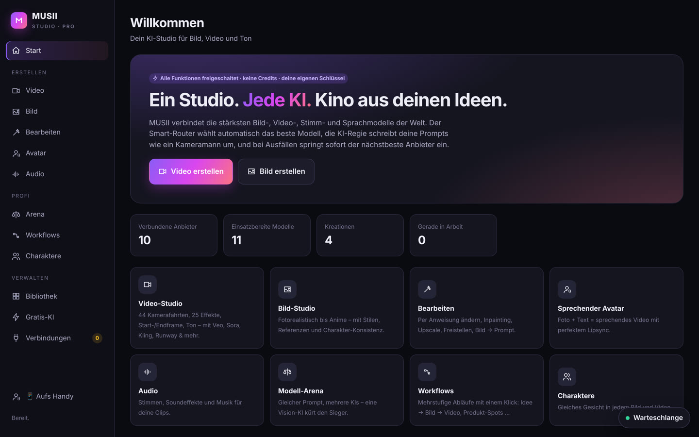
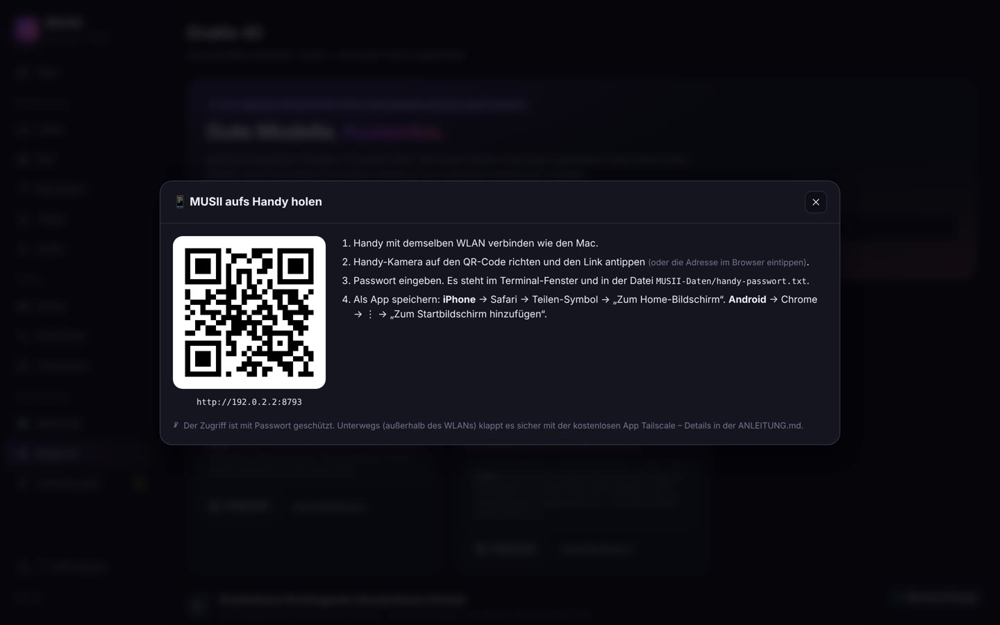
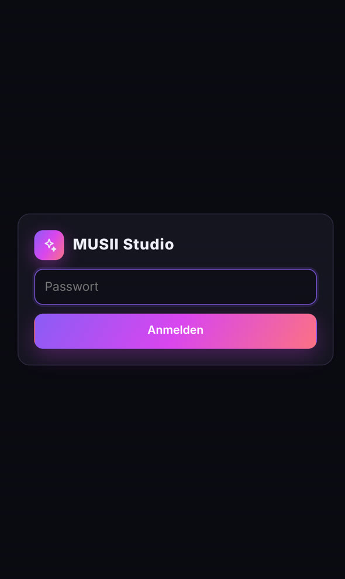
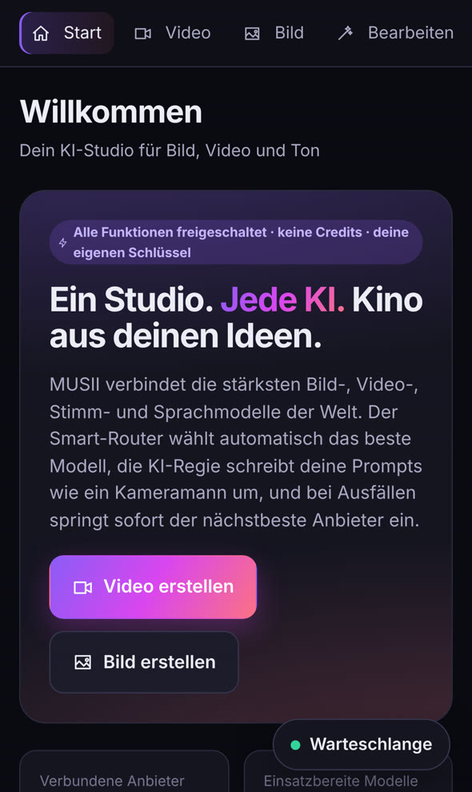
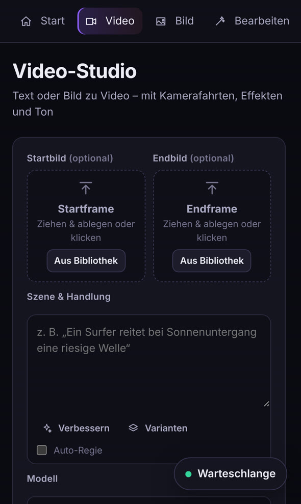
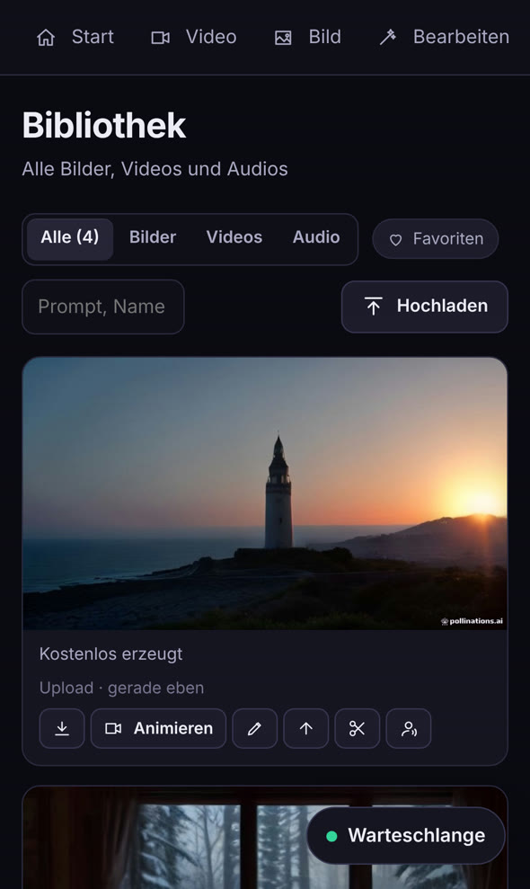
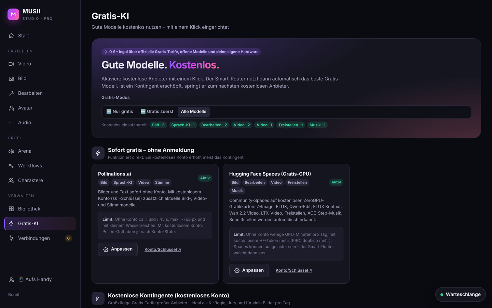

# MUSII Studio: Schritt-für-Schritt-Anleitung (Mac & Handy)

Diese Anleitung setzt **keine Vorkenntnisse** voraus.

**So funktioniert MUSII:** Die App läuft als kleines Programm auf einem Rechner, meist deinem Mac. Bedient wird sie im Browser. Dieselbe Oberfläche öffnest du auf dem Mac, auf dem iPhone oder auf dem Android-Handy.

**Welcher Weg passt zu dir?**

| Du hast … | Nimm |
|---|---|
| einen Mac | **Teil A** (10 Minuten), danach optional **Teil B** fürs Handy |
| einen Mac und willst unterwegs aufs Handy | **Teil A → B → C** |
| nur ein Handy (iPhone oder Android) | **Teil D** (läuft kostenlos in der Cloud) |

Danach geht es für alle mit **Teil E: Erste Schritte** weiter.

---

## Teil A: Auf dem Mac installieren und starten

### Schritt 1: Node.js installieren (einmalig)

1. Öffne **https://nodejs.org/de/download** in Safari oder Chrome.
2. Lade den **macOS-Installer (.pkg)** der **LTS-Version** herunter.
3. Öffne die heruntergeladene Datei und klicke dich durch den Installer (*Fortfahren → Installieren*, Mac-Passwort eingeben).

> Node.js ist die Laufzeitumgebung, die MUSII braucht. Du musst damit sonst nichts tun.

### Schritt 2: MUSII herunterladen

1. Öffne im Browser diesen Link (du musst bei GitHub angemeldet sein):
   **https://github.com/mikkamusik/musii/archive/refs/heads/ccr-fc6b6791-z4u4c3.zip**
2. Die ZIP-Datei landet in *Downloads*. Doppelklicke sie, dann entsteht ein Ordner wie `musii-ccr-fc6b6791-z4u4c3`.
3. Zieh den Ordner an einen festen Ort, z. B. in deinen *Dokumente*-Ordner, und benenne ihn in **`MUSII`** um.

> Alternativ über die Website: github.com/mikkamusik/musii → oben links den Branch **ccr-fc6b6791-z4u4c3** wählen → grüner Button **Code** → **Download ZIP**.

### Schritt 3: Per Doppelklick starten

1. Öffne den Ordner `MUSII`.
2. Doppelklicke **`MUSII-starten.command`**.
3. Ein Terminal-Fenster öffnet sich:
   - Beim **ersten Start** installiert es automatisch alles Nötige. Das dauert 1–2 Minuten.
   - Danach öffnet sich **MUSII automatisch im Browser** unter `http://127.0.0.1:8787`.
4. **Lass das Terminal-Fenster offen**, solange du MUSII benutzt. Zum Beenden schließt du das Fenster.



**Der Mac sagt „kann nicht geöffnet werden, da der Entwickler nicht verifiziert ist“?**
Das ist normal bei Dateien aus dem Internet. So geht es trotzdem:
- **Variante 1:** *Systemeinstellungen → Datenschutz & Sicherheit* → ganz nach unten scrollen → bei „MUSII-starten.command wurde blockiert“ auf **Dennoch öffnen** klicken.
- **Variante 2:** Rechtsklick (oder Ctrl+Klick) auf die Datei → **Öffnen** → **Öffnen**.
- **Variante 3 (klappt immer):** Programm **Terminal** öffnen, `bash ` eintippen (mit Leerzeichen), die Datei ins Terminal-Fenster ziehen und **Enter** drücken.

> 💾 Deine Bilder, Videos und Einstellungen liegen im Ordner **`MUSII-Daten`** in deinem Benutzerordner. Bei Updates bleiben sie erhalten.

---

## Teil B: Mit dem Handy nutzen (gleiches WLAN)

Der Mac rechnet, das Handy bedient. Das klappt mit iPhone und Android.

### Schritt 1: Den Handy-Modus starten

1. Ist MUSII schon offen? Dann schließe das Terminal-Fenster.
2. Doppelklicke im Ordner `MUSII` auf **`MUSII-mit-Handy-starten.command`**.
3. Fragt der Mac: *„Soll das Programm ‚node‘ eingehende Netzwerkverbindungen akzeptieren?“* → **Erlauben**.
4. Im Terminal stehen jetzt die **Handy-Adresse** (z. B. `http://192.168.178.23:8787`) und ein **Passwort** (z. B. `wolke-welle-339`).

> 🔒 Das Passwort schützt MUSII vor anderen Geräten im WLAN. Am Mac selbst brauchst du kein Passwort. Es steht auch in `MUSII-Daten/handy-passwort.txt`.

### Schritt 2: QR-Code scannen

1. Klicke am Mac in MUSII unten links auf **📱 Aufs Handy**.
2. Halte die **Kamera des Handys** auf den QR-Code und tippe auf den Link.
   *(Oder tippe die Adresse aus dem Terminal im Handy-Browser ein, mit `http://`, nicht `https://`.)*
3. Gib das **Passwort** ein und tippe auf **Anmelden**.



<p>




</p>

### Schritt 3: Als App auf den Home-Bildschirm legen

- **iPhone (Safari):** unten auf das **Teilen-Symbol** (Quadrat mit Pfeil) → **Zum Home-Bildschirm** → **Hinzufügen**.
- **Android (Chrome):** oben rechts **⋮** → **Zum Startbildschirm hinzufügen** bzw. **App installieren**.

Jetzt hast du ein MUSII-Symbol wie bei einer normalen App.

> 💡 Der Mac muss dabei **eingeschaltet sein und MUSII laufen**. Das Start-Skript verhindert automatisch, dass der Mac einschläft, solange MUSII läuft.

---

## Teil C: Unterwegs aufs Handy (außerhalb des WLANs)

Mit der kostenlosen App **Tailscale** erreichst du deinen Mac sicher von überall. Dabei wird nichts offen ins Internet gestellt.

1. Installiere **Tailscale** auf dem **Mac** (tailscale.com/download oder Mac App Store) und melde dich an, z. B. mit Google oder Apple.
2. Installiere **Tailscale** auf dem **Handy** (App Store / Play Store) und melde dich **mit demselben Konto** an.
3. Starte MUSII am Mac mit **`MUSII-mit-Handy-starten.command`** (wie in Teil B).
4. Klicke am Mac auf **📱 Aufs Handy** und wähle **„Tailscale (unterwegs)“**. Scanne den QR-Code.
   *(Die Adresse beginnt mit `http://100.…`.)*
5. Tailscale auf dem Handy einschalten, dann funktioniert MUSII auch im Mobilfunknetz.

> ⚠️ Bitte **keine Portfreigabe im Router** einrichten. Tailscale ist der sichere Weg.

---

## Teil D: Nur mit dem Handy (ohne Mac)

### Variante 1: GitHub Codespaces (iPhone & Android, empfohlen)

MUSII läuft dabei kostenlos auf einem Cloud-Rechner von GitHub. GitHub gibt laut eigener Angabe privaten Konten ein monatliches Gratis-Kontingent (Stand kann sich ändern).

1. Öffne im Handy-Browser (angemeldet bei GitHub):
   **https://codespaces.new/mikkamusik/musii/tree/ccr-fc6b6791-z4u4c3**
   *(Klappt der Link nicht: Repo öffnen → Branch **ccr-fc6b6791-z4u4c3** wählen → **Code** → Reiter **Codespaces** → **Create codespace**. Auf dem iPhone ggf. vorher in Safari über „aA“ → **Desktop-Website anfordern**.)*
2. Tippe auf **Create codespace** und warte, bis alles eingerichtet ist. Das dauert beim ersten Mal ca. 3–5 Minuten.
3. MUSII startet automatisch. Öffne unten den Reiter **Ports** (bzw. „Anschlüsse“) und tippe bei **8787 – MUSII Studio** auf das **Globus-Symbol** („Im Browser öffnen“).
4. Optional: Diese Seite wie in Teil B, Schritt 3 **zum Home-Bildschirm** hinzufügen.
5. **Wichtig:** Wenn du fertig bist, den Codespace **stoppen** (github.com/codespaces → ⋯ → *Stop codespace*), damit das Gratis-Kontingent nicht verbraucht wird. Deine Daten bleiben erhalten.

> 🔒 Die Adresse ist privat. Nur du kannst sie öffnen, solange du bei GitHub angemeldet bist.

### Variante 2: Android direkt (für Technik-Fans)

1. Installiere **Termux** aus **F-Droid** (die Play-Store-Version ist veraltet).
2. In Termux nacheinander eingeben:
   ```
   pkg update && pkg install nodejs-lts git ffmpeg
   git clone -b ccr-fc6b6791-z4u4c3 https://github.com/mikkamusik/musii.git
   cd musii && npm install && npm run build && npm start
   ```
   *(Bei einem privaten Repo fragt git nach Benutzername und einem GitHub-Token als Passwort.)*
3. In Chrome **http://127.0.0.1:8787** öffnen.

> Auf dem **iPhone allein** kann MUSII nicht direkt laufen (Apple erlaubt das nicht). Nimm dort Variante 1.

---

## Teil E: Erste Schritte in MUSII

### Schritt 1: Gratis-KI aktivieren (kostenlos, ohne Konto)

1. Links im Menü (am Handy oben in der Leiste) auf **Gratis-KI** tippen.
2. Bei **Pollinations.ai** → **Einrichten** → **Gratis aktivieren**.
3. Bei **Hugging Face Spaces (Gratis-GPU)** → **Einrichten** → **Gratis aktivieren**. Alle Spaces sind vorausgewählt.
4. Oben bei **Gratis-Modus** auf **🆓 Nur gratis** tippen.



### Schritt 2: Dein erstes Bild

1. **Bild** öffnen.
2. Idee eintippen, z. B. *„Ein Leuchtturm bei Sonnenuntergang über ruhigem Meer, Fotografie“*.
3. Optional einen **Stil** antippen (z. B. *Kino*).
4. **Bild erzeugen** tippen. Das Ergebnis erscheint nach einigen Sekunden.
   *Tipp:* **✨ Verbessern** formuliert deine Idee zu einem Profi-Prompt um.

### Schritt 3: Aus dem Bild ein Video machen

1. Unter dem Bild auf **Animieren** tippen. Das Bild wird zum Startbild im **Video-Studio**.
2. Eine **Kamerabewegung** wählen (z. B. *Dolly In*). Bis zu drei Bewegungen lassen sich kombinieren.
3. Beschreiben, was passiert, z. B. *„Wellen brechen am Felsen, Möwen fliegen durchs Bild“*.
4. **Video erzeugen**: Im Gratis-Modus nimmt MUSII *Wan 2.2* oder *LTX-Video* auf Gratis-GPUs.
   **Oder** als Modell **⚡ Local Motion** wählen. Das rendert die Kamerafahrt sofort und unbegrenzt im Browser.

### Schritt 4: Alles wiederfinden

- **Bibliothek:** alle Bilder, Videos und Audios mit Download, Favoriten, *Verlängern*, *Upscale*, *Freistellen*.
- **Warteschlange** (unten rechts): zeigt, was gerade gerechnet wird.

---

## Teil F: Mehr Gratis-Kontingent mit kostenlosen Konten (je 2–3 Minuten)

Alles wird auf der Seite **Gratis-KI** eingetragen. Schlüssel sind wie Passwörter: nicht weitergeben.

### Hugging Face (mehr Gratis-GPU für Video, Bild & Musik)
1. Konto anlegen auf **huggingface.co/join**.
2. **huggingface.co/settings/tokens** → **Create new token** → Typ **Read** → Name z. B. „MUSII“ → **Create token** → **kopieren**.
3. In MUSII: **Gratis-KI → Hugging Face Spaces → Anpassen** → Token einfügen → **Aktualisieren**.

### Cloudflare Workers AI (über 100 Bilder pro Tag gratis)
1. Konto anlegen auf **dash.cloudflare.com/sign-up**.
2. **dash.cloudflare.com/profile/api-tokens** → **Create Token** → Vorlage **„Workers AI“** → **Use template** → **Continue to summary** → **Create Token** → **kopieren**.
3. **Account-ID** finden: im Cloudflare-Dashboard auf der Startseite deines Kontos (rechte Seitenleiste bzw. bei „Account ID“ → kopieren).
4. In MUSII: **Gratis-KI → Cloudflare Workers AI → Einrichten** → Token und Account-ID einfügen → **Gratis aktivieren**.

### Google Gemini (kostenlose KI-Regie & Bewertung)
1. **aistudio.google.com/apikey** öffnen (mit Google-Konto anmelden).
2. **API-Schlüssel erstellen** → **kopieren**.
3. In MUSII: **Gratis-KI → Google Gemini → Einrichten** → einfügen → **Gratis aktivieren**.
   *Keine Zahlungsdaten hinterlegen, dann bleibt es im kostenlosen Tarif.*

### Optional: Premium-Qualität (kostenpflichtig, pro Ergebnis)
Für Spitzenmodelle wie **Veo, Kling, Sora, Runway** unter **Verbindungen** einen Schlüssel eintragen. Am einfachsten ist **fal.ai**: ein Schlüssel für fast alle Top-Video-Modelle. Mit **🆓 Gratis zuerst** nutzt MUSII trotzdem zuerst die kostenlosen Modelle.

---

## Teil G: Updates

1. Neue ZIP wie in **Teil A, Schritt 2** herunterladen und entpacken.
2. Den alten `MUSII`-Ordner löschen und durch den neuen ersetzen.
3. Wie gewohnt **`MUSII-starten.command`** doppelklicken. Neue Teile werden automatisch eingerichtet.

Deine Daten in `MUSII-Daten` bleiben dabei unberührt.

---

## Probleme & Lösungen

| Problem | Lösung |
|---|---|
| Terminal meldet „Node.js ist noch nicht installiert“ | Teil A, Schritt 1 ausführen, dann erneut doppelklicken |
| Browser öffnet sich nicht | Selbst **http://127.0.0.1:8787** im Browser öffnen |
| „address already in use“ / Port belegt | MUSII läuft schon in einem anderen Terminal-Fenster. Das alte schließen |
| Handy findet den Mac nicht | Gleiches WLAN? **Gäste-WLAN** blockiert Geräte untereinander. Mit **Handy-Modus** gestartet? Mac-Firewall: *Systemeinstellungen → Netzwerk → Firewall → Optionen* → „node“ erlauben. Adresse mit **http://** eintippen |
| Passwort vergessen | Steht in `MUSII-Daten/handy-passwort.txt` (im Finder: Benutzerordner) |
| „Space-Fehler / GPU-Kontingent erschöpft“ | Das tägliche Gratis-Kontingent ist aufgebraucht. Hugging-Face-Token eintragen (Teil F), später erneut versuchen oder **Local Motion** nutzen. MUSII weicht automatisch auf andere Gratis-Modelle aus |
| Pollinations ist langsam | Ohne Konto ist es gedrosselt (ca. 1 Bild pro 45 s). Das ist normal |
| Video im Browser (Local Motion) klappt nicht | Aktuelles Safari oder Chrome nutzen. Den Tab während des Renderns geöffnet lassen |
| Mac schläft ein, Handy verliert Verbindung | MUSII über die `.command`-Datei starten (hält den Mac wach) und das Netzteil anschließen |
